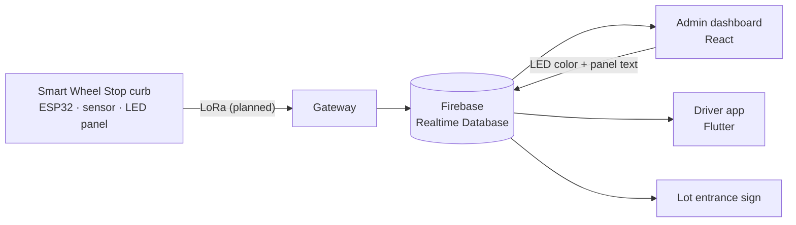

<p align="center">
  
</p>

<h1 align="center">Smart Wheel Stop</h1>

<p align="center">
  A solar-powered smart parking curb that knows when a spot is taken,<br>
  tells drivers where to go, and lets admins run every lot from one screen.
</p>

<p align="center">
  
  
  
  
  
  
</p>

<p align="center">
  <b>FAU Engineering Senior Design · Fall 2026 · Team Smart Curb</b><br>
  <a href="https://smartcurb-d174e.web.app">Admin dashboard</a> ·
  <a href="https://smartcurb-d174e--demo-azspi0b7.web.app">Live demo</a> (until Oct 31, 2026)
</p>

---

## The problem

Finding parking is slower and more stressful than it should be. A spot that looks open from the lane turns out to have a small car tucked into it. Permit signs are easy to miss, so it's not obvious which rows are red permit and which are blue. Drivers loop the same lots over and over, which means more traffic, more frustration, and more chances for a collision.

The Smart Wheel Stop replaces the ordinary concrete curb at the front of each parking space with one that **detects whether the spot is taken**, **shows the zone with a colored LED panel**, and **reports live to a central system** that drivers and staff can both see.

## How it works



1. Each curb senses whether a car is parked and reports its status, battery level, and health.
2. Everything lands in one shared Firebase Realtime Database.
3. The **driver app** shows which lots have room and routes drivers to the best one.
4. The **admin dashboard** shows every curb live, and can change any curb's LED color and panel text remotely, so a permit zone can be changed without repainting a single curb.
5. A **lot entrance sign** shows open spaces for drivers who aren't using the app.

## What's in the system

### Admin dashboard · `admin-dashboard/`

| Page | What it does |
|---|---|
| **Overview** | Live totals, occupancy for every lot, and alerts for offline curbs and low batteries |
| **Parking lots** | A tile for every curb, plus remote control of each curb's LED color and panel text |
| **Curb units** | Every curb in one table, with filters for offline, low battery, and open spots |
| **Lot sign** | A full-screen entrance sign view, built for a TV or projector |
| **Assistant** | Answers plain-language questions like *"where should I park?"* from live data |
| **Analytics** | Occupancy heatmap by day and hour, plus a live occupancy trend |
| **Users & roles** | Viewer, Operator, and Manager access, with invite-only sign-up |
| **Simulation** | Start, stop, and script the traffic simulator (shown in Simulation mode) |
| **Settings** | Change password, pick Live or Simulation data, set alert thresholds |

It updates in real time, works on phones and tablets, and has a built-in traffic simulator that never touches real curbs.

### Driver app · `smart_curb/`

A Flutter app with a map of campus lots showing live availability, with A\* routing that recommends the best lot for where the driver is headed.

### Hardware

Solar panels and rechargeable batteries power each curb. An ESP32 microcontroller reads an ultrasonic sensor and drives the LED panel. LoRa networking is planned for getting readings from the curbs to the database.

## Tech stack

| Layer | Technology |
|---|---|
| Admin dashboard | React, Vite, React Router |
| Driver app | Flutter |
| Backend | Firebase Authentication, Firebase Realtime Database, Firebase Hosting |
| Routing | A\* search |
| Curb hardware | ESP32, ultrasonic sensor, LED panel, solar + rechargeable batteries |
| Curb networking | LoRa (planned) |

## Repository layout

```
Smart_Curb/
├── admin-dashboard/        React admin console
│   ├── src/pages/          One file per page
│   ├── src/components/     Shared layout and animated numbers
│   ├── src/demo/           Demo data and traffic simulator
│   ├── scripts/            Deploy safety check
│   ├── database.rules.json Firebase security rules (draft, not published)
│   └── .env.demo           Settings for demo mode
├── smart_curb/             Flutter driver app
├── run_parking_test.py     A* parking algorithm test
└── README.md
```

## Getting started

### Admin dashboard

You'll need [Node.js](https://nodejs.org) (LTS version).

```bash
cd admin-dashboard
npm install
npm run dev
```

Open http://localhost:5173. Sign-up is invite-only: a Manager invites you from **Users & roles**, then you create your account with that exact email.

| Command | What it does |
|---|---|
| `npm run dev` | Run locally with real data |
| `npm run dev:demo` | Run locally as the demo site (simulated data only) |
| `npm run emulators` | Start local Auth + Database emulators with the draft rules (needs Java 21+) |
| `npm run dev:emulator` | Run locally against the emulators instead of the real database |
| `npm run build` | Build the real site into `dist/` |
| `npm run build:demo` | Build the demo site into `dist-demo/` |

### Driver app

You'll need the [Flutter SDK](https://docs.flutter.dev/get-started/install).

```bash
cd smart_curb
flutter pub get
flutter run -d chrome
```

On Windows, Flutter needs **Developer Mode** turned on (Settings → System → For developers).

### Deploying

From `admin-dashboard`, with the [Firebase CLI](https://firebase.google.com/docs/cli) installed:

```bash
# Real site (deploys dist/)
npm run build
firebase deploy --only hosting

# Demo site (deploys dist-demo/)
npm run build:demo
firebase --config firebase.demo.json hosting:channel:deploy demo --expires 30d
```

Real and demo builds go to different folders, and every build writes a `build-info.json`. Before any hosting deploy, `scripts/check-build.mjs` runs automatically and **blocks the deploy** if the folder holds the wrong kind of build (or no build at all). You can run the same check yourself with `npm run check:real` or `npm run check:demo`.

The security rules are not part of `firebase.json`, so `firebase deploy` can't publish them by accident. See *Security rules* below.

## Data model

```
lots/<lotId>
    name           "Lot 6"
    openSpots      7        optional, legacy (see below)
    totalSpots     20       optional, legacy (see below)
    units/         { "C-001": true, ... }

units/<curbId>
    lot            "lot06"
    occupied       true / false
    online         true / false
    battery        0 to 100
    ledColor       red | blue | green | gold | white
    panelText      up to 16 characters

users/<uid>        Dashboard accounts: email, role, last active, siteId (see Customer scoping)
schedules/<siteId> Timed states: settings, rules, applied (see Timed states)
invites/<email>    Pending dashboard invites (dots in the email become commas)
drivers/<uid>      Driver app accounts
demo/              Same shape as above, used only for demos
```

A few rules keep everything in sync:

- A curb's `lot` must match its lot's ID **exactly**, including upper and lower case.
- Lot IDs are zero-padded (`lot06`, `lot07`) so they sort in the right order.
- A lot's **capacity is its curbs that aren't offline**, and its free spots are the ones of those that report free; offline curbs count in neither. A lot with no curbs has no capacity yet ("No curbs yet"). The dashboard, lot sign, company console, both Assistants and the driver app all count this way from `units/` (`lotCounts()` in `admin-dashboard/src/unitStatus.js`).
- `openSpots` and `totalSpots` are optional and nothing on the dashboard reads them. New lots from the console don't get them; existing lots keep theirs, and the Simulation keeps its simulated lots' values in step with the curbs.

## Customer scoping

There is one customer dashboard build at one address. The signed-in account decides which customer's lots and curbs it shows.

### Linking an account to a customer

1. Find the customer's id under `sites/` in the Firebase console (the company console's customer page shows the same customers; the id is the key under `sites/`, for example `-NxAbC123`).
2. Find the account's uid under `users/` (or in Firebase Authentication).
3. Set `users/<uid>/siteId` to that customer's id.

Only platform admins (or the Firebase console, which ignores the rules) can set, change or remove `siteId`. A user can't set it at sign-up, a manager can't set it on anyone, their own record included, and the value must be the id of an existing customer under `sites/`. New accounts created from an invite start unlinked until someone links them.

A platform admin who also uses the customer dashboard needs a `users/<uid>` record (invite them like anyone else) as well as `platformAdmins/<uid> = true`.

### What the scoping does

After sign-in the dashboard works out a scope (`src/scope.js`), and every page passes its data through it (`useScoped()` in `src/useScope.js`):

- **Platform admin**: all customers by default, with a **Viewing** switcher under the brand to pick one customer or All.
- **An account with `siteId`**: that customer's lots (`lots/<id>/siteId` equals it) and only the curbs whose `lot` is one of them. The header shows the customer's name if the rules let the account read it; today `sites/` is readable by platform admins only, so it says "Your customer".
- **An account with no `siteId`**, in Live: a screen saying "Your account isn't linked to a customer yet. Ask Smart Wheel Stop to link it." and no data, Setup included.
- **Simulation** shows the simulator's data, unscoped, for everyone: it's fake, and the banner says it's the same for every account.

This covers Overview, Parking lots and Lot detail, Curb units (search included), Analytics' live occupancy and latency samples, Setup, the Users list (that customer's staff plus accounts not linked yet), the Assistant (answers, counts and chips; another customer's lot gets "couldn't find") and the lot sign (the dashboard's **Open lot sign** link adds `?site=<id>`). Occupancy history (`history/`) is recorded for every customer together, so with one customer in view Analytics and the Assistant say so instead of showing it. The Live hardware card on Overview appears only when its curb is in the scope.

### The honest limit

The scope controls what each dashboard **shows**. It is not access control. The database rules still let any signed-in staff account read every customer's `lots/`, `units/`, `history/`, `latency/`, `users/` and the shared `config/` and `settings/`; the lot sign's data (`lots/`, `units/`) is public, so `/sign` without `?site=` shows every lot; and any manager can still change any account's role. Someone with a staff account and the browser's developer tools could read another customer's data.

Future work, if customers must be kept apart by the database itself:

- **Per-customer read rules**: group data by customer (for example `customers/<siteId>/units/<id>` and `customers/<siteId>/lots/<id>`) so a rule can grant `users/<uid>/siteId === $siteId`. Rules can't filter a list, so today's flat `units/` can't be split per customer. The Receiver, the sign, the driver app and the simulator would all need to read and write the new paths.
- **A separate Firebase project per customer**, with its own database, accounts and hosting.

## Timed states

Managers schedule how vacant curbs look: "10 PM to 6 AM: dim to 10%", or "Mon to Fri, 7 AM to 5 PM: show RESERVED in gold". The curbs have no clock, so a runner on the server writes each change when it's due, using the same three fields the manual LED control writes (`ledColor`, `panelText`, `ledBrightness`), so nothing changes for the Receiver. Curbs already turn their LEDs off when occupied, so this only sets the vacant look.

### Data model

```
schedules/<siteId>/settings          { enabled, timezone (IANA), default: look }
schedules/<siteId>/rules/<ruleId>    { name, enabled, days: [0-6, 0 = Sunday], start: "HH:MM", end: "HH:MM",
                                       target: { type: "site" | "lots" | "units", ids: [...] },
                                       look, priority: 0-9, updatedAt, updatedBy }
schedules/<siteId>/applied/<unitId>  { key, at }   what was last applied
look                                 { ledColor, panelText, ledBrightness }
```

The limits are the manual control's: colours red, blue, green, gold and white; 16 characters of panel text; brightness a whole percent from 0 to 100. A site can't be switched on without a default look. Anyone linked to the site and platform admins read it; that site's managers and platform admins write it.

### How a look is chosen

`admin-dashboard/shared/schedule.js` is pure, and the page, the runner and the tests all use it. Times are wall-clock times in the site's timezone. A window's start is inclusive and its end exclusive, and a window crossing midnight belongs to the day it starts, so Friday 22:00 to 06:00 is active on Saturday at 03:00. Start equal to end is refused. When several match: highest priority, then the more specific target (curbs, then lots, then the whole site), then the later start. With none active, the default look shows. Disabled rules are ignored, and a disabled site isn't touched at all.

### The runner

`admin-dashboard/scheduler/runOnce.js` goes through each enabled site's curbs and writes a look only when it differs from what was last applied, in batched multi-path updates. A manual LED edit therefore stays until the next scheduled change. Three things run it:

- **`functions/`**: a scheduled Cloud Function, every minute, with the Admin SDK. Deploy it with `firebase deploy --only functions --config firebase.functions.json` from `admin-dashboard/` (needs the Blaze plan). A plain `firebase deploy` doesn't include it.
- **`npm run scheduler:once`**: one pass against the local emulator. Add `-- --at 2026-11-06T23:00:00-05:00` to pretend it's another time. It refuses any other host.
- **Apply now** on the Schedules page: the same code from the browser, for that one site, as the signed-in manager.

The page is in the customer dashboard only, not the company console. In Simulation, timed states stay in the browser tab: they try out the timeline and preview on simulated curbs and write nothing.

### Known limits

- **A scheduler has to be running.** With no function deployed, nothing changes on its own; Apply now is the only trigger, and a change due overnight waits until someone presses it. The page says when curbs haven't got their look yet.
- **A curb that reboots shows its default** until the Receiver resends its settings. The runner doesn't see this: it compares against what it last applied, not what the panel shows.
- **Changes land up to a minute late**, and only while the function runs.
- **Daylight saving follows the clock.** A window inside the skipped hour doesn't run that night, one inside the repeated hour runs twice, and an overnight window is an hour shorter or longer in real time.
- **There's no all-day window.** Start can't equal end, so 00:00 to 23:59 leaves one minute a day; use the default look for what should always show.
- **Reads cost bandwidth.** While any site is on, each run downloads `lots/` and `units/`, once a minute. With no site on, it reads only `schedules/`.
- **Curb writes aren't limited per customer.** As with the manual control, the rules let any operator or manager write any curb's LED fields; `schedules/` itself is per site. See *The honest limit* above.
- **Apply now needs a role that can set LEDs.** A platform admin whose dashboard role is viewer can edit schedules, but the database refuses their Apply now.

## Live and Simulation data

We have one real curb, so the dashboard can also show a full set of simulated curbs. The **Data source** switch (sidebar and Settings) picks what this browser shows:

- **Live** reads `units/` and `lots/`, where the hardware Receiver writes C-095.
- **Simulation** reads `demo/`. A blue banner stays on every page while it's on.

The simulator only ever writes under `demo/`, and refuses any write outside it, so it can't touch C-095 even if someone switches to Live while it runs (switching to Live also stops it). Only one browser can run the simulation at a time. The demo site (`npm run build:demo`) is locked to Simulation. The lot sign shows simulated data only when opened with `/sign?source=sim`.

The **Simulation** page provides:

| Control | What it does |
|---|---|
| **Start / Stop simulation** | Cars arrive and leave every two seconds, and every screen updates live |
| **Rush hour in Lot 6** | Fills Lot 6 almost instantly |
| **Take a curb offline** | Knocks a random curb offline to trigger an alert |
| **Bring all curbs online** | Restores every offline curb |
| **Load fresh simulated data** | Creates 94 curbs across Lots 6, 7, 12, and 14, plus a week of occupancy history |

## Security rules

`admin-dashboard/database.rules.json` is a **draft that has not been published**. It limits each role to what it should do and keeps driver accounts out of staff data. Test changes locally with `npm run emulators`.

The hardware Receiver writes with the legacy database secret (Ryan confirmed), which bypasses security rules, so publishing them doesn't interrupt it. The rules file has an optional **Receiver section** for when the Receiver moves to a Firebase Auth account: fill in its UID and it can write only `occupied`, `lastUpdated`, and `lastSnapshot` on `units/`. Until then the placeholder matches no one, which is safe to publish.

## Roles

| Role | Can do |
|---|---|
| **Viewer** | See occupancy, battery, and curb status |
| **Operator** | Everything a Viewer can, plus change LED colors and panel text |
| **Manager** | Everything, plus invite people and change roles |

## Working in this repo

- **Run `git pull` before you start**, every time.
- **`main`** is the real product. Work in progress goes on its own branch and comes into `main` through a pull request.
- If `git status` shows generated Flutter plugin files you didn't mean to change, run `git restore smart_curb` from the repo root before committing or switching branches.

## Roadmap

- [ ] Publish the Firebase security rules by Oct 22 (deadline Oct 27)
- [ ] Move the Receiver from the database secret to a Firebase Auth account (fill in the Receiver section of the rules)
- [ ] Receiver heartbeat, then turn on the stale-curb alert in Settings
- [ ] LoRa gateway writing live curb readings and lot counts
- [ ] LED control (Node 2) so dashboard LED changes reach the curb
- [ ] Exact GPS position for every curb, for spot-level navigation
- [ ] Separate data for each customer facility
- [ ] AI language model behind the Assistant
- [ ] Facility type and theme setup for new customers

## Team

| Name | Focus |
|---|---|
| Ryan Hart | Power, sensors, and hardware integration |
| Brad Middlebrook | A\* parking efficiency algorithm |
| Tuan Nhat Tran | Driver app, map, and routing |
| Tim Perez | Microcontroller and security |
| Naqib Chowdhury | Admin dashboard and system architecture |

<p align="center"><sub>Built at Florida Atlantic University</sub></p>